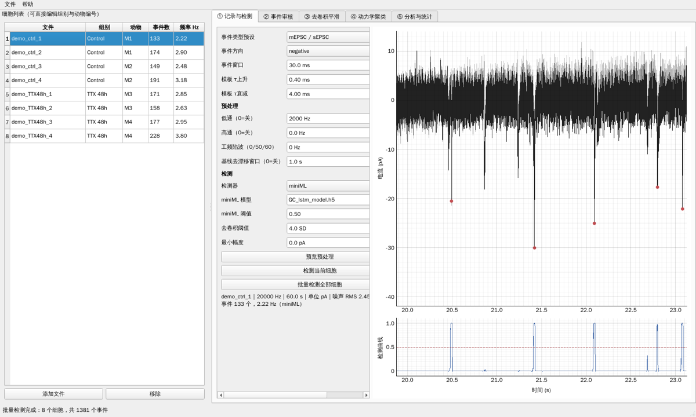
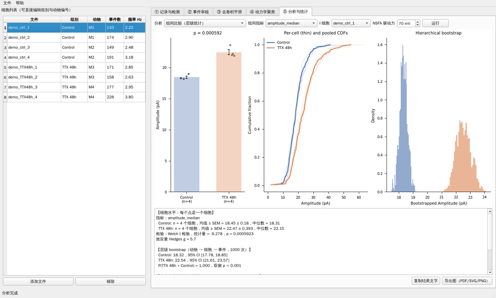

# 膜片钳分析 PatchClampAnalysis

分析膜片钳全细胞记录中 m/sEPSC、m/sIPSC 的图形界面软件，中文界面。
直接读取 Axon `.abf` 文件，用 [miniML](https://github.com/delvendahl/miniML) 深度学习模型检测事件，
在此基础上做检测质控、动力学聚类、去卷积平滑，以及以细胞和动物为单位的论文级统计与作图。

## 功能



| 页面 | 内容 |
| --- | --- |
| ① 记录与检测 | 读取 ABF / HDF5，预览原始与预处理后的记录；miniML 检测（可选自带模型或迁移学习模型）或去卷积检测；事件类型预设（EPSC / 高氯或低氯内液的 IPSC）；批量检测 |
| ② 事件审核 | 逐事件查看原位波形，排除误检；全部事件叠加与平均 |
| ③ 去卷积平滑 | Wiener 正则化 FFT 去卷积 + 高斯平滑；由平均事件拟合模板；去噪重建曲线与事件率曲线，分开重叠事件 |
| ④ 动力学聚类 | 波形形状或标量特征 → PCA / UMAP → GMM / K-means / HDBSCAN；先检验是否真的存在多簇（BIC、轮廓系数）；单细胞或全部细胞合并 |
| ⑤ 分析与统计 | 细胞总览、检测质控、上升时间–幅度相关、事件时间依赖性、PS-NSFA、量子多峰分析、E/I 联合分析、组间比较（层级统计）、突触缩放、各簇组成比较 |

每项分析都给出图和一段可直接复制的文字结论，图可导出为矢量 PDF / SVG 或 600 dpi PNG / TIFF。


详细说明与每种分析的读图方法见 [docs/教程.md](docs/教程.md)。

## 安装

需要 **Python 3.11**（miniML 依赖的 TensorFlow 2.14/2.15 只支持到 3.11）。

```bash
git clone https://github.com/zjm199502/patch_clamp_analysis.git
cd patch_clamp_analysis
python3.11 -m venv .venv
# Windows:
.venv\Scripts\activate
# macOS / Linux:
source .venv/bin/activate
pip install -e .
```

Windows 上也可以直接双击 `packaging\install_and_run.bat`（第一次会自动安装），macOS / Linux 运行 `packaging/install_and_run.sh`。
打包成独立的 exe：在仓库根目录运行 `packaging\build_windows.bat`。
新用户也可以到 [Releases](https://github.com/zjm199502/patch_clamp_analysis/releases) 下载安装包。

## 使用

```bash
python -m patchclamp_gui
```

1. 「文件 → 打开记录」选择一个或多个 `.abf`（也可以先用「文件 → 载入模拟演示数据」体验完整流程）。
2. 在左侧细胞列表里填写组别和动物编号（统计以细胞/动物为单位）。
3. 选择事件类型预设，点「批量检测全部细胞」。
4. 在「事件审核」里排除误检，然后依次使用去卷积、聚类和分析页面。
5. 「文件 → 导出结果表」得到逐事件表和每个细胞的汇总表（CSV）。

## 开发

```bash
pip install -e .[dev]
pytest
```

代码结构：

| 位置 | 内容 |
| --- | --- |
| `patchclamp_gui/io` | ABF / HDF5 读取，模拟数据 |
| `patchclamp_gui/core` | 预处理、检测、特征、去卷积、聚类、质控、时间依赖、统计、作图（不依赖界面） |
| `patchclamp_gui/gui` | PySide6 界面、软件内更新 |
| `patchclamp_gui/updater.py`、`patching.py` | 更新检查、小版本更新包的安装与回退 |
| `packaging/` | 打包与一键运行脚本 |
| `tools/bump_version.py` | 升级版本号并在 CHANGELOG 里加一节 |

## 发布新版本（维护者）

1. 运行 `python tools/bump_version.py`（末位 +1），在 `CHANGELOG.md` 新加的 `## vX.Y.Z` 一节里写更新说明（会显示在软件的更新对话框里）。
2. 如果换了依赖库、改了 `packaging/launcher.py`，或者新代码用到了以前没用过的标准库模块，把 `packaging/min_base.txt` 改成这个版本号（会重新打包整个程序）。
3. 合并到 main 后，在 Actions → “Build and release” 里运行，填入版本号。
   - 每个版本都会进入软件内更新通道（GitHub 上名为 `updates` 的 pre-release）。
   - 版本规则：x.y.0 是大版本，发布带安装包的正式 Release；之后的 x.y.1 … x.y.10 是小版本，只进入软件内更新；
     x.y.10 之后的下一个版本是大版本 x.(y+1).0（`bump_version.py` 会自动进位）。例：0.1.0 → 0.1.1 → … → 0.1.10 → 0.2.0。

## 引用

事件检测使用 miniML：O'Neill P.S. et al. (2025) A deep learning framework for automated and generalized synaptic event analysis. *eLife* 13:RP98485.
